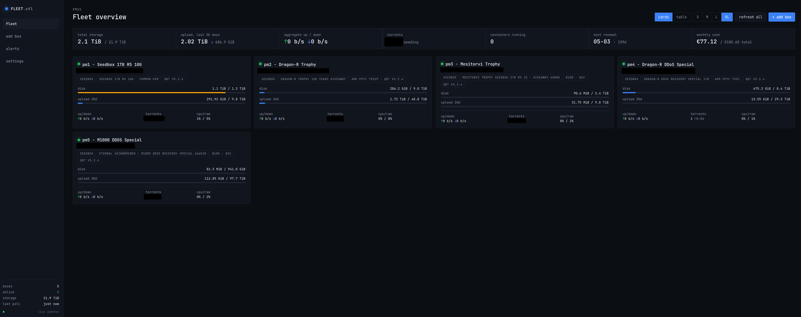
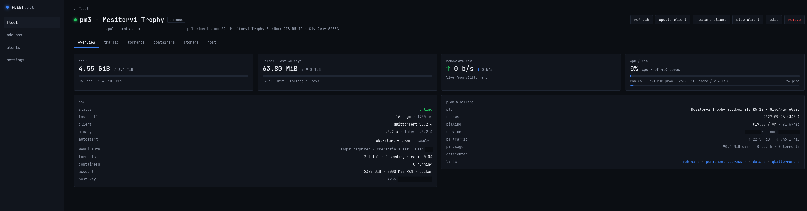
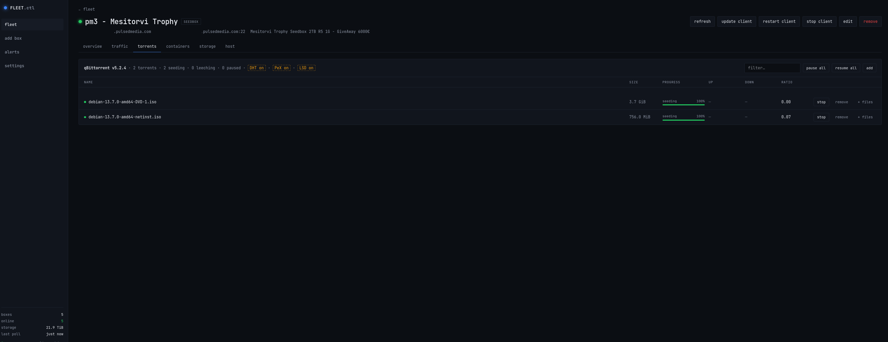

# pmss-fleet-manager

A single-pane-of-glass dashboard for [Pulsed Media](https://pulsedmedia.com)
seedboxes and storage boxes running the
[PMSS](https://github.com/MagnaCapax/PMSS) stack. One Go binary, no agents on
the boxes: it logs into each one over SSH as your own tenant user and reads
what PMSS already exposes, plus your self-installed `qbittorrent-nox` Web API
and rootless Docker socket through the same connection. Optionally it also
pulls plan names, prices and renewal dates from the Pulsed Media customer API.

Built for the common case of a customer with several boxes on shared hosts:
no root, nothing to install server-side, and nothing exposed to the internet
beyond the dashboard itself.



## Features

**Fleet view.** Every box as a card or table row with status, disk against
quota, upload for the rolling 30-day window PMSS enforces, live up/down rates,
torrent count and share ratio, CPU/RAM of your systemd slice, host CPU model
(and hardware encoder, e.g. Intel QSV on N100 hosts), qBittorrent version with
an update flag, and plan tags. Headline tiles for total storage, upload,
aggregate bandwidth, torrents, containers, next renewal and monthly cost.

**Torrents.** Every seedbox's torrents in one table, busiest first, with
the same columns as the per-box tab (name, size, progress, rates, lifetime
uploaded / downloaded, ratio, connected seeds and peers with the swarm
size) followed by the client and the box name (with whichever of DHT / PeX /
LSD is enabled on it in parentheses) linking to that box's torrents tab;
filter and per-torrent stop / start / remove controls. Every column
sorts on a click of its heading (again to reverse, a third time for the
default order); the choice is remembered per table in the browser.

**Per box.**

- Overview: disk, upload with limit/bonus/throttle state, bandwidth, CPU/RAM
  (your slice against its quota and as a share of the whole host), client,
  incoming connectivity and listen port, autostart status, plan and billing.
- Traffic: daily upload/download bars for the rolling 30 days PMSS tracks.
- Host: the shared machine's cpu (busy, iowait, steal), memory and `/home`,
  and PMSS's own 24-hour "node vs. you" statistics (15 min / 1 h / 24 h
  averages and a trend, computed as its panel computes them).
- Torrents: one table per client (qBittorrent, rTorrent), each sortable by
  any column. DHT / PeX / local peer discovery state in the header, each a
  toggle (and a card tag when any is on, for deciding where private-tracker
  torrents may go; rTorrent has DHT and PeX only);
  the full list from each client with filter; add torrents by
  magnet, URL or `.torrent` file (optionally into a category, or stopped);
  stop / start / remove (with or without the files) per torrent; stop all /
  start all; and start / stop / restart of the client.
- Containers: rootless Docker containers with CPU and memory, start / stop /
  restart.
- Transfers: copy a directory to a new directory on another of your boxes,
  straight from box to box with rsync over SSH (see *Copying between boxes*),
  with bytes, rate, rsync's estimate of progress, and the result.
- Services: every process the account runs on the shared host (PMSS hides
  the other tenants'), grouped into the applications the PMSS stack ships or
  that customers commonly install: qBittorrent, rTorrent, Deluge, Radarr /
  Sonarr / Prowlarr and friends, Jellyfin, Plex, SABnzbd, pyLoad, FlexGet,
  Cloudplow, rclone, Syncthing, Resilio, lighttpd, Docker, FFmpeg, shell
  sessions. Per application: process count, resident memory, CPU share since
  the previous poll, uptime, listening ports and a link to where PMSS serves
  it. "Watch" an application to get an alert when it is not running. The
  processes using the most memory (up to 300) sit below, filterable.
- Logs: the log files found in the usual places under the home (PMSS's
  `~/.logs` and tracker cleaner, qBittorrent, Radarr / Sonarr / Prowlarr and
  friends, Jellyfin, SABnzbd, Deluge, rclone, FlexGet, pyLoad, Cloudplow,
  lighttpd) and every container's output. Pick one and the last 300 lines
  are read from the box on demand, with a line filter; nothing is streamed
  or stored.
- Storage: usage by top-level directory from a low-priority `du`, every few
  hours or on demand.
- Host: uptime, load, memory and CPU of the shared host, GPU/render node
  access, PMSS account settings.





**qBittorrent lifecycle.** Install or update `~/bin/qbittorrent-nox` from the
[userdocs static build](https://github.com/userdocs/qbittorrent-nox-static)
(URL configurable). The download's sha256 is checked against the digest
GitHub publishes for the release asset (any GitHub release URL; other
sources install unverified and say so), then an ELF and `--version` check
runs before the binary is swapped in atomically. The dashboard checks the latest GitHub release every
six hours and flags boxes that are behind or that need a restart to pick up a
new binary. "Set up autostart" writes a `~/bin/qbt-start` screen launcher and
the `@reboot` and `*/5 * * * *` crontab entries without touching other
crontab lines (a line that runs the helper along with something else is
kept), after saving the previous crontab to
`~/.config/pmss-fleet-manager/crontab.bak`. An existing helper is left alone
unless its running check keys on `$USER`, which is empty under cron (so
`pgrep -u ""` fails and the helper starts another copy every five minutes):
the dashboard flags such a helper next to the autostart row, and "reapply"
rewrites it after saving the old one to
`~/.config/pmss-fleet-manager/qbt-start.bak`. Where qBittorrent is enabled in
the Pulsed Media panel, PMSS runs and configures it itself: the dashboard
still monitors it, but refuses to install, autostart or start a build of its
own, and its restart only stops the client and leaves starting it to the
panel's watchdog.

**Alerts.** Unreachable box, suspended account, disk at threshold or over
quota, traffic at threshold, throttled, qBittorrent or Docker down,
qBittorrent without incoming connectivity (firewalled or disconnected) for
more than ten minutes, container
exited non-zero, a watched application not running, process memory near the
slice limit, a kernel OOM kill in
the slice, renewal within N days or overdue (counted in calendar days of the
dashboard host's time zone; keep it the same as yours). Alerts
auto-resolve, can be acknowledged or dismissed, and the count shows in the
sidebar. Live updates arrive over server-sent events.

**Pulsed Media customer API.** Paste a read-only API key from the client area
(`https://pulsedmedia.com/clients/index.php?m=pmapi`) into settings. Services
are matched to boxes by hostname and username, which fills in plan name, price
per cycle and per month, next due date, web UI and permanent-address links, and
Pulsed Media's own usage accounting. Services you have not added yet get an
"add box" shortcut; it prefills the host and username and leaves plan and
renewal date blank on purpose, so the box keeps showing the live API values
(the wizard says so and previews them). The feed is synced every six hours and
on demand. Manual plan and renewal values on a box take precedence, and a
typed renewal date does not follow the next billing cycle. Only Active and Suspended
services count towards costs and renewal alerts; any other status (Cancelled,
Terminated, Pending, Fraud, Completed) stays listed but counts towards
neither.

**pmdb.fyi hardware catalogue (opt-in).** [pmdb.fyi](https://pmdb.fyi) is a
community-run public table of Pulsed Media host hardware
([source](https://github.com/schmintendo/pmdb)). Tick the box in settings and
enter the catalogue's shared upload key, and the dashboard looks up the host
each of your boxes runs on in the public list and submits the ones that are
missing, from the facts the probe already reads: hostname, CPU model, core
count, nominal clock, RAM, swap, home filesystem size and whether an Intel GPU
is present. Nothing about your account, username, usage or torrents leaves
the dashboard (as with any web request, the service sees your IP address and
the client name), an existing row is never replaced, and the check runs after a
box's quarter-hourly inventory (asking the catalogue only while a host still
needs deciding), every six hours, and on demand. The settings
page lists each host's standing (listed, submitted, pending, or the error).
Off by default; untick the box or remove the key to stop it. What is
submitted is what each box reports about itself: turning this on trusts
your boxes' probe output with the shared key, so a compromised account on
one box could get a made-up host row submitted in your name (at most 50
per run and never over an existing row, but not a lifetime limit: a box
that keeps reporting new hostnames gets each one tried at a later run).
Leave it off if that matters to you.

## Run

Requires Go 1.27 or later to build (go.mod names the exact toolchain and the go command fetches it). No other runtime dependencies.

**Run it on a machine you control**, such as a home server, a NAS, a VPS or
your workstation, and **not on a Pulsed Media seedbox, storage box or any
other shared host.** The dashboard holds the SSH and WebUI credentials for
every box in your fleet. File modes and the optional encryption keep
other user accounts out of the database, `-auth` protects the dashboard
itself, and the loopback bind limits access to the local machine, which
on a shared host is exactly where the other tenants are: every one of
them can open a loopback port. None of it protects against privileged
access, and on a shared host the provider's staff and anyone who gets
root are on the same kernel as the database and the process memory. That
is outside the threat model; see *Security and hardening*.

```sh
make build                                 # or: go build -o pmss-fleet-manager ./cmd/pmss-fleet-manager
./pmss-fleet-manager                       # http://127.0.0.1:8080, data in ./data
mkdir -p -m 700 ~/.config/pmss-fleet-manager
(umask 077; printf '%s' 'me:secret' > ~/.config/pmss-fleet-manager/auth)
./pmss-fleet-manager -listen 127.0.0.1:8080,10.11.0.13:8080 -auth-file ~/.config/pmss-fleet-manager/auth -data /var/lib/pmss-fleet-manager
```

`-auth me:secret` works too, but it puts the password in the process list,
where every user on the machine can read it.

Flags, or the matching environment variables `PMSS_LISTEN`, `PMSS_DATA`,
`PMSS_AUTH`, `PMSS_AUTH_FILE`, `PMSS_SSH_KEY`, `PMSS_MONITOR_ONLY`, `PMSS_LOG`,
`PMSS_ALLOWED_HOSTS`, `PMSS_BASE_PATH`, `PMSS_SECRET_FILE`,
`PMSS_SECRET_PREVIOUS_FILE`,
`PMSS_FORGET_ENCRYPTED_CREDENTIALS`; `PMSS_SECRET` and
`PMSS_SECRET_PREVIOUS` exist only as environment variables:

| flag | default | meaning |
|---|---|---|
| `-listen` | `127.0.0.1:8080` | bind address, or several comma-separated |
| `-data` | `./data` | directory for the SQLite database (created 0700) |
| `-auth` | none | HTTP basic auth as `user:password`; set it if you bind to a non-loopback address |
| `-auth-file` | none | file holding that login as `user:password` (a container secret, say); one trailing line ending is ignored and nothing else, so a password may end in a space. A configured file that is missing, empty or not `user:password` stops the start. Set this or `-auth` / `PMSS_AUTH`, not both |
| `-ssh-key` | none | private key file tried for every box without a key path of its own, before `~/.ssh/id_*`; a box's own key path always wins |
| `-monitor-only` | off | refuse the web UI's actions on the boxes (`PMSS_MONITOR_ONLY=1`): torrent, client, discovery, container and transfer actions answer 403 and their controls are hidden; monitoring runs as usual. Adding, editing and removing boxes, alerts, settings, refresh, du and log reads still work. It limits this interface, not the SSH keys it holds: see *Security and hardening* |
| `-log` | `info` | `debug`, `info`, `warn`, `error` |
| `-allowed-hosts` | none | extra Host header names to serve, comma-separated, e.g. the name a reverse proxy uses; the listen addresses and localhost are always allowed, and on a wildcard bind (`0.0.0.0`, `::`) so is any IP address |
| `-base-path` | none | URL prefix when a reverse proxy serves the dashboard under a sub-path and forwards it unchanged, e.g. `/fleet` (then open `https://proxy/fleet/`); leave unset if the proxy strips the prefix before forwarding |
| `-secret-file` | none | file holding the secret that encrypts the stored credentials, or set `PMSS_SECRET` to the secret itself; see *Encrypting stored credentials* below. Unset keeps them in plain text |
| `-previous-secret-file` | none | when changing or removing the secret: file holding the one the credentials are encrypted with now, or set `PMSS_SECRET_PREVIOUS`; for one start |
| `-forget-encrypted-credentials` | off | after losing the secret: remove every stored credential that does not decrypt, then start |

### Encrypting stored credentials

Box SSH passwords, qBittorrent WebUI passwords, the Pulsed Media API key
and the pmdb.fyi upload key live in the SQLite file, as do two settings that
may carry a token: each box's qBittorrent start command and the qBittorrent
download URL. By default they are in plain text, protected by the file's
mode (0600 in a 0700 directory). To encrypt them, give the dashboard a
secret from outside the data directory:

```sh
openssl rand -base64 32 > /etc/pmss-fleet-manager.secret && chmod 600 /etc/pmss-fleet-manager.secret
./pmss-fleet-manager -secret-file /etc/pmss-fleet-manager.secret
# or, for a container:  -e PMSS_SECRET="$(openssl rand -base64 32)"
```

- **What it protects.** A copy of the database on its own: a backup, an
  appdata share on the LAN, a file attached to a bug report, a file-read
  bug. It does not protect against whoever can read the process's
  environment or the secret file on the same host, which is the same
  person who could read a 0600 database. So the secret must not travel
  with copies of the database: not in the data directory, not in a
  backup set that includes it, and not in a container template or compose
  file that sits on a share exported next to the data (on Unraid the
  template XML is on the flash drive; see *Running in a container*). A
  secret file on an unexported path, mounted read-only, is the safe
  default; the environment variable is for setups where nothing writes
  the environment to disk.
- **The secret must be random**, at least 24 characters and ideally the 44
  that `openssl rand -base64 32` prints. The key is derived with HKDF
  (no stretching), so a memorable passphrase could be brute-forced offline
  against the very file this guards. Keep a copy in a password manager:
  a lost secret means re-entering every password and key.
- **First start with the secret** encrypts the credentials already in the
  database, then vacuums the file and truncates the write-ahead log so the
  plain text is not left in free pages; if that cleanup is interrupted it
  is finished at the next start before anything is served. The same scrub
  runs once more when a release adds columns to what is encrypted (1.12
  added the qBittorrent start command and download URL), so plain text a
  column held before it was encrypted, even one already cleared, does not
  stay behind either. The database
  records whether its credentials are encrypted and keeps a small key
  check (a fixed string sealed under the secret), so that marker, not what
  a value looks like, decides: a password that happens to start with
  `pmss1:` is a password in a store marked plain text, and the secret is
  verified at every start even when no credential is stored yet. The one
  time a value's shape is consulted is a database that has no marker yet
  (never opened by a release with encryption support, or metadata lost):
  a credential there that is exactly shaped like this dashboard's
  ciphertext is refused rather than sent to a box as a password. Nothing
  changes in the dashboard.
- **Starting without the secret, or with a different one, is refused** with
  a log line saying so, or naming the first credential it could not read.
  The pollers would otherwise present ciphertext to your boxes as the
  password. Fix the environment and start again; nothing is lost. The same
  refusal covers a database whose encryption markers were damaged or only
  partly restored: the dashboard fails closed rather than guess, and the
  log line says what to do.
- **Changing or removing the secret:** for a single start, give the old
  one as `PMSS_SECRET_PREVIOUS` or in a file named by
  `-previous-secret-file` / `PMSS_SECRET_PREVIOUS_FILE`. Credentials are
  rewritten under the new secret, or back to plain text when no current
  secret is configured at all: neither `PMSS_SECRET`, nor
  `PMSS_SECRET_FILE`, nor `-secret-file`. Remove the previous one once
  that start has succeeded. In a container, run the rotation as a one-off
  `docker run --rm` with both files mounted rather than editing the
  template, so the old secret is never recorded there.
- **Lost the secret:** start once with `-forget-encrypted-credentials`
  (or `PMSS_FORGET_ENCRYPTED_CREDENTIALS=1`). Credentials that do not
  decrypt are removed, the rest of each record stays, and the edit forms
  ask for the passwords again (a forgotten start command means the default
  start, a forgotten download URL the default build). It is also the way
  through a damaged marker: whatever still decrypts with the configured
  secret is kept. Unset it afterwards.
- **Do not roll back to a release before 1.9 with an encrypted
  database.** An older build knows nothing about the encryption and would
  present the ciphertext to your boxes as the password. Switch encryption
  off first: start once with the current secret given as the previous one
  (`PMSS_SECRET_PREVIOUS`, `-previous-secret-file` or
  `PMSS_SECRET_PREVIOUS_FILE`) and every current-secret input removed
  (`PMSS_SECRET`, `PMSS_SECRET_FILE` and `-secret-file`). That start's
  log no longer says `stored credentials are encrypted` and, if anything
  was stored, says `rewrote stored credentials ... encrypted=false`; then
  downgrade.
  The same goes for a release before 1.12 once 1.12 has run with the
  secret: those read the start command and download URL as plain text, so
  starting qBittorrent would run the ciphertext as a command on the box
  and installs would refuse the URL.
- The format is AES-256-GCM with the column name as additional data, the
  key derived with HKDF-SHA256 from the secret; stored values start with
  `pmss1:`. The SSH key files a box points at are not touched: they are
  yours to protect, and the agent keeps them out of reach altogether.

### Running in a container

Each release also publishes a multi-arch image (linux amd64 and arm64) built
from the `Dockerfile`: a distroless base with nothing but the binary, CA
roots and time-zone data, running as an unprivileged user.

```sh
docker run -d --name pmss-fleet-manager \
  -p 127.0.0.1:8080:8080 \
  -v pmss-data:/data \
  -e TZ=America/Chicago \
  ghcr.io/alteredparadox/pmss-fleet-manager:latest
```

- The image listens on `0.0.0.0:8080` and keeps its database in `/data`.
  Every flag is available as the matching environment variable, so `-e
  PMSS_AUTH=me:secret` or `-e PMSS_BASE_PATH=/fleet` configure it.
- To encrypt the stored credentials, mount a secret file read-only and
  point `PMSS_SECRET_FILE` at it, for example `-v
  /path/to/secret:/run/pmss-secret:ro -e PMSS_SECRET_FILE=/run/pmss-secret`.
  The file must live somewhere a copy of the data directory does not
  travel with it: on Unraid that means a share whose SMB/NFS export is
  off, not `appdata`, and not the flash drive. **Do not put the secret in
  an Unraid template variable:** the template is saved in plain text on
  the flash drive, which is often exported as the `flash` share next to
  `appdata`, so the secret and the database would leak together.
  `-e PMSS_SECRET=...` is fine where the environment is not written to a
  shared place, but `docker inspect` and the compose file show it. Keep
  a copy of the secret outside the container either way: see *Encrypting
  stored credentials* for what happens when it is missing, changed or lost.
- The process runs as uid 65532. A named volume as above works out of the
  box; a bind-mounted directory has to be writable by that uid (`chown
  65532:65532 ./data`), or run the container with `--user "$(id -u)"`. If
  it is not, the container exits at once with a log line naming the
  directory, the uid it ran as and both fixes. Rootless Podman maps uids
  differently: see *Rootless Podman and Quadlet* below.
- **Unraid:** appdata folders belong to `nobody:users`, so either put
  `--user 99:100` in the template's *Extra Parameters* or `chown -R
  65532:65532 /mnt/user/appdata/pmss-fleet-manager`. The image does not read
  `PUID`/`PGID`; `--user` is the equivalent. SSH keys are looked up in
  `/home/nonroot/.ssh` whatever `--user` says, since the image sets `HOME`.
- Set `TZ` to the zone you want renewal days counted in; without it the
  container is UTC.
- Boxes that authenticate with an SSH key need the key inside the container:
  mount it read-only, for example `-v ~/.ssh/id_ed25519:/home/nonroot/.ssh/id_ed25519:ro`,
  or point the box's key path at wherever you mount it. The mounted key must
  be readable by the uid the container runs as: copy it, `chown 65532` and
  `chmod 600` the copy, or run with `--user` matching the file's owner. An
  unreadable default key is named in the connection error. For an agent,
  mount the socket and pass `SSH_AUTH_SOCK`. Password auth needs nothing extra.
- Because it listens on all interfaces, the Host-header check serves
  `localhost` and any IP address; any other name, such as the one a reverse
  proxy uses, has to be listed in `PMSS_ALLOWED_HOSTS`. Publishing the port on
  `127.0.0.1` as above and fronting it with a TLS reverse proxy is the
  intended setup.
- **Secrets as files.** The login, the credential secret and the SSH key can
  all come from mounted files, which keeps them out of `docker inspect`
  and the compose file: `-e PMSS_AUTH_FILE=/run/secrets/pmss-auth` (the file
  holds `user:password`), `-e PMSS_SECRET_FILE=/run/secrets/pmss-credkey`,
  and `-e PMSS_SSH_KEY=/run/secrets/pmss-key` for boxes without a key path
  of their own. Each must be readable by the container's uid.
- **Healthcheck.** The image has no shell or curl; the binary checks itself.
  `pmss-fleet-manager healthcheck` GETs `/healthz` on the address in
  `PMSS_LISTEN` (a wildcard bind is reached on loopback) and exits 0 or 1;
  `/healthz` is served at the root whatever the base path, needs no login
  and does not count against the failed-login throttle. The check runs as
  its own process and cannot see the server's flags: if you change the
  listen address, do it with `PMSS_LISTEN` rather than `-listen` (or set
  `PMSS_HEALTHCHECK_URL`), or the container reads as unhealthy. The
  Dockerfile declares it, which Docker uses; Podman ignores a Dockerfile
  healthcheck in OCI images, so with Podman or Quadlet set it yourself:
  `HealthCmd=CMD /pmss-fleet-manager healthcheck` (the leading `CMD` selects
  exec form; the image has no `/bin/sh`).
- **Hardening.** Only `/data` has to be writable: the image runs with a
  read-only root filesystem (`--read-only`, Quadlet `ReadOnly=true`, no
  `/tmp` tmpfs needed), `--cap-drop ALL` and `--security-opt
  no-new-privileges`. CI starts every image that way.

### Rootless Podman and Quadlet

The image runs unchanged under rootless Podman, as a systemd service through
a Quadlet unit. The notes below come from a user running it that way and
were checked on Podman 5.4.2 with crun on Debian 13: the unit at the end
started healthy on a read-only root with every capability dropped, the
login, credential secret and SSH key came from Podman secrets, and the
ownership recipes behaved as described. Restarting on a failed healthcheck
and starting at boot were not exercised. CI tests the image with Docker.

- **Ownership of `/data`.** Rootless Podman maps the container's uid 65532
  to a subordinate uid on the host (the start of your `/etc/subuid` range
  plus 65531, e.g. 231067 for a range starting at 165536), not to you, so
  `chown 65532:65532` on the host gives the wrong owner. A fresh named
  volume works as it is: Podman copies the image's `nonroot`-owned `/data`
  into it on first use (a volume that already exists keeps its ownership).
  For a bind mount, either `podman unshare chown 65532:65532 ./data`, or
  run with `--userns=keep-id:uid=65532,gid=65532` (Quadlet
  `UserNS=keep-id:uid=65532,gid=65532`) so the files belong to your own
  user.
- **Secrets.** The login, the credential secret and the SSH key can all be
  Podman secrets, mounted as files under `/run/secrets` with the owner and
  mode set in the container, so nothing has to be copied or chowned and
  nothing sits in the unit file or `podman inspect`:

  ```sh
  IFS= read -rsp 'Dashboard login (user:password): ' a; echo   # IFS= keeps leading/trailing spaces
  printf '%s' "$a" | podman secret create pmss-fleet-auth -; unset a
  openssl rand -base64 32 | podman secret create pmss-fleet-credkey -
  podman secret create pmss-fleet-key ~/.ssh/pmss_fleet_ed25519
  ```

  **Use crun with a read-only root.** With `ReadOnly=true`, secrets mounted
  under `/run/secrets` need the crun runtime, Podman's default when it is
  installed: under runc the container fails to start with "make mountpoint
  /run/secrets/...: read-only file system". Check with
  `podman info --format '{{.Host.OCIRuntime.Name}}'`; Podman picks runc
  when crun is missing, for example when Docker's runc is already there,
  so `apt install crun` (or drop `ReadOnly=true`).

  **Back them up separately.** Podman's default secret driver keeps
  secrets unencrypted (base64 in one JSON file) under
  `~/.local/share/containers/storage/secrets/`, next to `storage/volumes/`.
  A backup of that whole tree carries the credential secret together with
  the database it protects, which *Encrypting stored credentials* says to
  avoid: back up the volume on its own and keep the secret in a password
  manager.
- **Backup and restore.** Stop the service first: the database runs in
  SQLite's WAL mode, and an archive taken while it writes can catch the
  database and its write-ahead log at different moments. A clean stop
  folds the log into the database, so the archive is that one file.

  ```sh
  systemctl --user stop pmss-fleet-manager
  systemctl --user is-active pmss-fleet-manager   # inactive
  podman volume export pmss-fleet-data -o pmss-fleet-data.tar
  systemctl --user start pmss-fleet-manager
  ```

  To restore into a fresh volume, import the archive and give the volume
  back to the container's user: Podman sets a new volume's owner from the
  image only when it is empty at first use, so an imported one is left
  owned by your own user and the dashboard cannot write it ("attempt to
  write a readonly database").

  ```sh
  podman volume create pmss-fleet-data
  podman volume import pmss-fleet-data pmss-fleet-data.tar
  podman unshare chown -R 65532:65532 "$(podman volume inspect -f '{{.Mountpoint}}' pmss-fleet-data)"
  ```

  The restored database needs the same credential secret it was
  encrypted with.
- **Healthcheck.** Podman does not take the Dockerfile's healthcheck from
  an OCI image, so set it in the unit (`HealthCmd=CMD ...`: the leading
  `CMD` selects exec form, and the image has no `/bin/sh`).
  `Notify=healthy` makes systemd count the unit as started only once a
  check passes, and `HealthOnFailure=kill` with `Restart=on-failure`
  restarts a container that stops serving. The first regular check runs
  one `HealthInterval` after the start, so on its own `Notify=healthy`
  holds the start for a minute; the startup check in the unit below
  (`HealthStartupCmd`, every 2 s until it passes) gets it there in about a
  second.
- **Firewall.** With rootless Podman's default `pasta` networking a
  published port is an ordinary host socket, so the host firewall's INPUT
  rules (UFW, nftables) apply to it, unlike rootful Docker. Publishing on
  one interface address (`PublishPort=100.x.y.z:8080:8080`) works, but the
  address must exist when the container starts.
- **Start at boot.** A rootless Quadlet runs in your user's systemd
  instance; `sudo loginctl enable-linger "$USER"` starts that instance at
  boot without a login. It cannot wait on the system's
  `network-online.target`; Quadlet in Podman 5 adds its own user-level
  wait for the network, so the unit needs no network dependency of its
  own.
- **Pin a version.** Releases are tagged `X.Y.Z`, `X.Y` and `latest`. An
  encrypted database cannot go back to a release before 1.9 (before 1.12
  once 1.12 has run with the secret) without switching encryption off, and
  `podman auto-update` restarts onto whatever the tag points to, so pin
  `X.Y.Z` or a minor tag rather than `latest`.

A complete unit, `~/.config/containers/systemd/pmss-fleet-manager.container`:

```ini
[Unit]
Description=PMSS Fleet Manager

[Container]
Image=ghcr.io/alteredparadox/pmss-fleet-manager:1.12
ContainerName=pmss-fleet-manager
PublishPort=127.0.0.1:8080:8080
Volume=pmss-fleet-data:/data
Environment=TZ=America/Chicago
Secret=pmss-fleet-auth,type=mount,target=/run/secrets/pmss-fleet-auth,uid=65532,gid=65532,mode=0400
Environment=PMSS_AUTH_FILE=/run/secrets/pmss-fleet-auth
Secret=pmss-fleet-credkey,type=mount,target=/run/secrets/pmss-fleet-credkey,uid=65532,gid=65532,mode=0400
Environment=PMSS_SECRET_FILE=/run/secrets/pmss-fleet-credkey
Secret=pmss-fleet-key,type=mount,target=/run/secrets/pmss-fleet-key,uid=65532,gid=65532,mode=0400
Environment=PMSS_SSH_KEY=/run/secrets/pmss-fleet-key
ReadOnly=true
NoNewPrivileges=true
DropCapability=all
HealthCmd=CMD /pmss-fleet-manager healthcheck
HealthInterval=60s
HealthTimeout=5s
HealthRetries=3
HealthStartPeriod=20s
HealthStartupCmd=CMD /pmss-fleet-manager healthcheck
HealthStartupInterval=2s
HealthOnFailure=kill
Notify=healthy

[Service]
Restart=on-failure
TimeoutStartSec=300

[Install]
WantedBy=default.target
```

```sh
sudo loginctl enable-linger "$USER"
systemctl --user daemon-reload
systemctl --user start pmss-fleet-manager
```

`PMSS_AUTH_FILE`, `PMSS_SSH_KEY` and the healthcheck need 1.11.0 or later;
with 1.10 or earlier, use `Secret=pmss-fleet-auth,type=env,target=PMSS_AUTH`
for the login (it then shows in the container's environment), mount the key
at `/home/nonroot/.ssh/id_ed25519` instead, and leave out the `Health*` and
`Notify` lines. To listen on another port, set `PMSS_LISTEN` rather than
passing `-listen`, so the healthcheck finds it.

### Adding a box

Open the UI and use **add box**. The wizard connects, pins the host key, runs
the probe and shows what it found (quota, traffic limit, qBittorrent binary and
WebUI port, Docker socket, CPU) before you confirm. SSH auth can be a key file,
your ssh-agent, or a password; with "auto" it tries the `-ssh-key` default
if one is set, then `~/.ssh/id_ed25519`, `id_ecdsa` and `id_rsa`, then the
agent, then a password if one is set.

### Editing a box

Blank password fields keep the saved passwords. They are only ever used for
the host, port and user they were saved for: moving a box to a different
endpoint with a blank SSH or WebUI password is refused until you re-enter
it (or remove it), both on save and on "test connection". Before any action
that logs in to the WebUI the dashboard re-reads the box's socket table to
confirm the port is still bound by your account. Switching SSH auth to a key or the agent
removes the saved SSH password; a checkbox removes the saved WebUI password.
Over the API, an edit (`PUT /api/boxes/{id}`) must carry the record's
`revision` as `GET` returned it; a stale one is refused with 409 and the
current record, which the edit form reloads into itself. Every request
that acts on a box (torrent, client, discovery, container and transfer actions,
adding torrents) must carry `?rev=` with the box's `box_rev` from
`GET /api/state`: 400 without it, 409 when the box was edited since.
An edit that moves the box to another host, port or account, or forgets
the pinned host key, starts it over as a new machine: nothing the old one
reported is carried or restored, its alerts except the renewal one are
resolved, and actions on it (qBittorrent, WebUI, containers, log reads)
answer 409 until the first complete probe; the page greys those buttons
meanwhile and `GET` shows the box's `ready` flag.
The pinned host key belongs to the host and port: it is kept while they are
unchanged, cleared when they change or when you tick "forget the pinned SSH
host key", and a key the wizard saw never replaces an existing pin. Because
the first connect after forgetting trusts whatever key answers, and with
password auth sends the SSH password to it, ticking "forget" asks you to
confirm.

### rTorrent

A box can run rTorrent beside or instead of qBittorrent; both are monitored
when enabled under edit. The dashboard talks to rTorrent over its SCGI
unix socket (`~/.rtorrent.socket`, read from `~/.rtorrent.rc` and
`~/.rtorrent.rc.custom`, or set per box as `unix:/path`), through the SSH
connection as the tenant, so no password is involved: the socket's
permissions decide who may connect. A socket path, discovered or set, must
be inside the account's home: one elsewhere could be another account's
daemon, so it is not dialed. A loopback TCP endpoint
(`tcp:127.0.0.1:port`) is accepted too, but SCGI has no authentication of
its own and on a shared host every tenant can reach the same loopback port:
anyone on the box could then drive your rTorrent. The dashboard checks that
the port is owned by your account before it connects, which keeps it from
talking to an impostor (on hosts whose socket-table privacy hides
established sockets this falls back to the listener check described under
qBittorrent access, with its narrow release-and-rebind window), but it
cannot keep others from talking to your rTorrent. Keep the unix socket
unless the host isolates loopback between tenants. The client is PMSS's own, started by the panel's watchdog, so there is no
install, start or stop for it here; the tenant's `~/.rtorrentDisable`
marker is shown and silences the alert. On a box running both clients the
torrents tab shows a table per client, each with its own counts, add button
and column sort; the fleet-wide torrents view has a client column (sortable
like the others). Torrent actions: stop, start, remove,
remove with data, add. Remove with data asks rTorrent for the
torrent's path, erases the torrent, then deletes on the box only after the
box itself resolved the path through symlinks and found it strictly inside
rTorrent's download root, which must itself be strictly inside the home.
The removal and the deletion then run under the dashboard's own deadlines:
closing the browser, editing the box or stopping the dashboard does not cut
them (a stop waits for an admitted deletion to finish). If the deletion
fails after your request has already ended, the outcome is not lost: it is
logged, shown under rTorrent on the box's torrents tab until you dismiss
it, and raised as an alert. Two limits remain.
A hard kill of the dashboard process after the removal and before the
deletion has completed leaves the torrent gone and all or part of its files
behind; those files are visible on the box and can be cleaned up by hand.
And a process of the same account that renames another directory into the
very name being removed, in the instant between the check and the removal,
can have that directory deleted instead; that data is only recoverable from
a backup.

**Peer discovery.** The rTorrent header has DHT and PeX toggles like
qBittorrent's (rTorrent has no local service discovery). A click writes the
setting to `~/.rtorrent.rc.custom`, which PMSS's own `~/.rtorrent.rc` imports
last, so it survives a restart: the first line already setting it (either
spelling, `dht.mode.set` / `dht`, `protocol.pex.set` / `peer_exchange`) is
replaced, later ones are dropped, and the rest of the file is kept as it
was; the file is replaced by a rename and keeps its mode, and a symbolic
link, a non-regular file or one over 1 MiB is refused. The setting is then
applied to the running client, and what the client reports afterwards is
shown. DHT off is written as `off`, not `disable`: both keep DHT from
running, but a client started with `disable` never initialises DHT and so
cannot turn it on until it is restarted; the toast says so, and the toggle
carries ↻ until the running client matches the file. PeX is a default,
not a switch on every torrent: rTorrent copies it into each torrent when the
torrent is loaded, so torrents loaded after the change get it, while those
already loaded keep their own setting, even when stopped and started again
(remove and re-add one to change it). The toggle, toast and indicators say
"default for new torrents" for that reason.

**Labels.** A label (ruTorrent's `custom1`) is attempted once, right after
the torrent is loaded, and never retried: the add's answer says how many
torrents were loaded with the label not applied or confirmed (rTorrent
refused it, or its answer was lost, so the label may or may not be set),
and the dashboard log says why. For a `.torrent` file that is the end of
it. A magnet only has a metadata placeholder at that moment; rTorrent drops
the placeholder's label when the metadata arrives and rebuilds the torrent,
and the dashboard does not set it again, because a later torrent with the
same hash cannot be told from the one you labelled and a missing label
beats a wrong one. Set a magnet's label in ruTorrent once its metadata has
arrived. Labels are a convenience, and the dashboard does not guard them
beyond this; what it
guards without compromise is deleting files, acting on the right machine
and account, and bounded operations against the box.

### qBittorrent access

The WebUI port is read from `~/.config/qBittorrent/qBittorrent.conf` on the
box unless you set one (both the 4.x `[Preferences]` and the 5.x `[WebUI]`
layouts are understood). Requests reach qBittorrent through the SSH tunnel, so
they arrive from the box's own loopback address. On a shared host other tenants
can reach that same loopback port, so keep WebUI authentication on and give the
dashboard the username and password rather than enabling the localhost bypass.

The poller never retries a rejected login: qBittorrent bans an IP after five
failures, its counter never decays, and on PMSS that loopback address is
shared with the `/user-<name>/` web path, so a ban would lock you out of
both. A rejected username/password is held until you change it, re-enter it
under edit, or restart the client from the dashboard (a fresh process has a
fresh counter). A detected ban is held for 65 minutes. Before any login the
probe also checks that the WebUI port is bound by your own uid, since on a
shared host another tenant could bind it while your client is down. It reads
`/proc/net/tcp`; on hosts where Pulsed Media's socket-table privacy option
has made that root-only it falls back to `ss -tlnp`, which still lists every
listener and can attribute your own to you.

"Start client" runs the per-box start command; when none is set it uses
`~/bin/qbt-start` if present, else `"$HOME/bin/qbittorrent-nox" -d`.

### Failures and backoff

A box that fails to poll is retried at the normal interval for the first few
failures, then the retry interval doubles up to ten minutes. The card shows
when the next try is due and offers "retry now", which reconnects at once.
The failure count and status survive edits and dashboard restarts, so a box
that is down stays "offline" (and its alert stays acknowledged) across them.
Disabling a box stops polling, resolves its open alerts and greys out its
actions; enabling it again starts from a clean slate. An alert whose source
could not be read on an otherwise good poll (quota command hung, traffic
file missing, docker daemon down) is kept rather than resolved and re-raised;
switching a source off for the box resolves its alerts.

### Copying between boxes

The transfers tab copies one directory from this box into a **new**
directory on another box. Pick the folder to copy with *browse* (or type
its path), choose the destination box, browse to an existing folder there
(or type it) and name the new folder. *Review copy* resolves both paths on
their boxes and shows them exactly, with the reminder that the source is
left untouched; *start copy* then sets it up and scrolls to its progress
card. The picker lists one folder's subfolders at a time (at most 1000,
symlinks not followed), never leaves the account's home, and shows no files. The data goes straight from box to box (Pulsed
Media does not charge for internal traffic); the dashboard only sets the
copy up, starts it and reads its status. This is copy only: no move, no
sync, no `--delete`, no queue, no retries.

How it is authenticated, per copy:

1. The source box generates a fresh ed25519 key in
   `~/.config/pmss-fleet-manager/transfers/<job>/`. The private half never
   leaves that directory and is deleted when the copy ends.
2. The dashboard adds the public half to the destination's
   `~/.ssh/authorized_keys` as one line,
   `restrict,expiry-time="<setup + 30 min>",command="/usr/bin/rrsync -wo -no-del -munge '<new dir>'"`:
   no shell, no forwarding, no PTY; it can only write into the new
   directory, cannot read anything and cannot delete; symlinks it sends are
   munged on arrival, so even a source that turned hostile (it holds the
   key) cannot use one to write outside the directory; no new login with
   it after 30 minutes (rsync connects once, so a long copy is not cut off).
   The file is edited under a lock by copy-and-rename; no other line is
   touched, and removal puts it back byte for byte (including `~/.ssh` and
   the file themselves if the copy created them).
3. The source connects to the destination's host name with the host key
   the dashboard has pinned for it, written into the job's own
   `known_hosts` (an RSA pin is negotiated with SHA-2 signatures): no trust
   on first use on the box, no agent, no forwarding of the dashboard's
   credentials.

Prerequisites: `rsync`, `rrsync` (Debian's rsync 3.2.4 or later ships it as
`/usr/bin/rrsync`) and OpenSSH 7.7 or later on the destination, and sshd
accepting public keys for your account. A destination without `rrsync` is
refused; there is no fallback to an unrestricted key. Both boxes need a
pinned host key (any box that has been polled once has one).

The copy runs as a detached process on the source, so it does not depend
on the dashboard or on an SSH session staying open; the dashboard reads its
status every 5 seconds. After a dashboard restart it goes on reading and
never starts a copy again (a launch can only ever run once). A copy is over
when rsync's exit code says so, not when its percentage reaches the end;
losing contact with the source shows "last seen", never a result. Its
output is kept bounded on the box (a few KiB per job, however long it runs).

Rules: both paths must resolve inside the account's home directory; the
destination must not exist yet (it is created atomically, so collisions
and two copies to one place are refused); the source may not overlap the
dashboard's control directory `~/.config/pmss-fleet-manager`; symlinks and
special files are skipped and counted, hard links arrive as separate files;
one copy at a time per source box. Free space is shown as a hint, not
checked: a copy that does not fit ends with "destination out of space or
quota". Files that change during the copy may arrive inconsistent, and
files that vanish give "completed with warnings". A partial copy is never
deleted. Cancel stops the copy: the files that arrived complete stay, the
one in flight is discarded by rsync. Cancel stops the copy the dashboard
started; it does not end other sessions opened with the job key while it
was valid (only a compromised source could open one, and it could still
only write into the new directory). A job binds to the
account and machine it started on: after an edit that points a box record
elsewhere, or forgets its pinned key, the job refuses to touch that box and
lists what may need removing by hand. An unfinished copy whose source box
was removed or now points elsewhere can be forgotten; the dashboard then
says it may still be running and does nothing on either box. Cleanup that could not be confirmed
(a box unreachable when the copy ended) is shown as "credential cleanup
needed" with a retry button, never as a failed copy.

## Security and hardening

The code went through a fourteen-round adversarial review before 1.0 (SSH
resiliency, remote-command safety, web/API, concurrency, parsers, dead code).
These are the design decisions that came out of it.

- **The threat model stops at the machine that runs the dashboard.** The
  design treats the boxes as hostile territory (tenant-only reads, pinned
  host keys, credentials never sent to a port you do not own) and the
  dashboard's own host as yours. There, 0600 files and the optional
  encryption restrict other UIDs, `-auth` protects the dashboard, and the
  default loopback bind limits remote network access; it does not keep
  other local users off the port. None of this defends against
  privileged access: root, another tenant with a kernel exploit, or the
  provider's staff. That is why the dashboard must not run on a seedbox,
  a storage box or any other shared host: it holds the keys to the whole
  fleet, and on a shared host the people you are keeping those keys from
  are on the same machine, with the loopback port in reach.

- **Tenant-only on a shared host.** Everything the dashboard reads comes from
  your own account: `/proc`, your cgroup, your home directory and the kernel's
  socket table. Probe output is tagged with a per-run secret delivered on
  stdin, so another process on the host cannot inject a section, and every
  remote string is length-bounded before it reaches state, the cache or the
  browser.
- **WebUI credentials never go to a port you do not own.** The qBittorrent
  password is sent only when the socket table (`/proc/net/tcp`, or `ss -tlnp`
  where that is root-only) shows the port bound by your uid
  alone, re-read live over the same SSH connection immediately before any
  stop, pause or resume; and after every new tunnel connection, before a
  byte is written, the established sockets on that port are checked to be
  yours too, so a co-tenant who grabs the port between the check and the
  connect gets the connection closed, not the credentials (on hosts whose
  socket-table privacy hides established sockets, the listener check is
  what applies). One login attempt runs at a time per box and its
  outcome is shared with every request that was waiting on it, so a burst of
  actions sends the credentials once. A rejected login is held until the
  credentials change or the client is restarted from the dashboard, and a
  ban is held 65 minutes, so a bad password cannot walk the box's loopback
  into qBittorrent's IP ban.
- **Host keys.** Trust on first use, pinned to host and port. A supplied key
  never silently replaces a pin; a host or port change, or "forget the pinned
  SSH host key" after a reinstall, clears it. Saved SSH and WebUI passwords
  are reused only for the exact host, port and user they were saved for;
  moving a box means re-entering them.
- **Secrets on disk.** Box credentials, the Pulsed Media API key, the
  pmdb.fyi upload key, the qBittorrent start commands and download URL are
  stored in the SQLite file, which is created mode 0600 before SQLite opens
  it so the -wal and -shm side files inherit the mode; the data directory
  is created 0700. They are plain text unless a secret is configured
  (`PMSS_SECRET` or `-secret-file`), in which case they are AES-256-GCM
  ciphertext under a key the database does not hold, so a copy of the
  file alone is harmless; a dashboard started without the secret refuses
  to run rather than present ciphertext as a password. The design and its
  limits are under *Encrypting stored credentials*. Prefer SSH keys or the
  agent regardless. Neither key is ever sent to the browser and passwords
  are never serialised.
- **The hardware catalogue is untrusted input.** With the pmdb.fyi
  integration on, the dashboard reads a third-party service that could be
  compromised or replaced. Its list is bounded in size and read for one
  fact only (which DNS-shaped hostnames exist; odd rows are skipped), the
  bytes counted are the entity's before any content decoding (compression
  is never asked for and a compressed answer is refused rather than
  decoded, since a gzip stream of any length can unpack to two bytes;
  transfer framing is bounded by Go's parser and the request deadline), no
  text from any
  response is kept, logged or shown (the service knows the shared upload
  key and could echo it in any encoding; an error is a fixed message or a
  status code), every request has its own HTTP/1.1 connection that is
  never reused, whatever the server answers (bytes a server sends after
  the answer it declared would otherwise be found on an idle connection
  and quoted into Go's standard logger, below anything the code can
  intercept; over HTTP/2 the byte caps would count data after framing and
  a stream's clean-up writes have no deadline of their own),
  the list is streamed with a hard row cap so a
  flood of tiny elements costs no more than its bytes, response headers
  are capped small and a submission's answer is its status code alone
  (the body is never read, so an acceptance cannot be turned into a
  failure by what follows it), a transport failure or a redirect is
  reported as a fixed message rather than Go's own text (which would
  carry a Location the service controls), redirects are refused, one run
  has a total time budget, a submission budget and stops at a rate limit
  or a service failure, every list failure holds the next runs for an
  hour, the automatic cost is bounded whatever the service sends (a check
  after an inventory fetches the list only while a host still needs
  deciding and at most every ten minutes; the six-hourly check and "check
  now" always fetch unless a hold applies), and the only decision its
  answer drives is whether
  a host is submitted, once: a host seen listed, accepted or reported as
  existing is settled for the life of the process, whatever a later list
  says, and a list that arrived in full counts even when the run it was
  fetched for was reset meanwhile. It cannot change what is collected or
  shown about a box. What a
  compromised catalogue can still do is inherent in talking to it: lie
  about which hosts are listed (so a host is submitted, or not), refuse or
  throttle, and see the request itself.
- **Bounded everything.** SSH dials, handshakes (including the agent),
  sessions and remote commands are bounded by contexts; a hung `quota` is run
  through a detached helper so it cannot stall the probe; remote stdout is
  capped at 16 MiB; error texts and alert titles are clipped; directory
  listings keep the 500 largest entries. The Docker container list is
  bounded by that body cap and a container count, not per container (names,
  ports): only your own account's daemon writes it, and the cap keeps it
  finite.
- **Honest state across edits and restarts.** Failed polls are persisted too,
  so a box that is down comes back as down after a dashboard restart and its
  acknowledged alert stays acknowledged. An alert whose source could not be
  read on a poll is kept rather than resolved and re-raised. Retries back off
  to every ten minutes, with "retry now" to reconnect at once. Every
  request that acts on a box (torrent, client, discovery and container
  actions, adding torrents) carries the box revision the page was drawn at
  as `?rev=` and is refused with 409 after an edit; an edit landing in the moment between that check and the action
  reaching the box is not locked out, which is accepted for a dashboard
  with one operator.
- **Monitor-only mode.** `-monitor-only` refuses, server-side, every action
  on a box's torrents, clients, discovery settings and containers, and the
  UI leaves those controls out. It is deny-by-default: a mutating route counts as box-changing unless
  it is listed as touching only the dashboard's own records or only reading
  from a box, so a route added later is refused until it is classified. It
  restricts what this web interface can do, not what the SSH accounts can
  do: the dashboard still holds working keys or passwords for every box, and
  anyone with the database and the secret can use them directly. It is not
  a promise that nothing is ever written on a box: monitoring runs as
  usual, as the account, with the side effects it always has (temporary
  files, and qBittorrent logging its own start when its version is read).
- **Web surface.** No authentication by default and bound to loopback: use
  `-auth` with a long random password, and put it behind a reverse proxy
  with TLS (and its own authentication or rate limiting) before exposing it
  further. The built-in throttle on wrong passwords is per client address,
  which behind a proxy is the proxy's, so it is deliberately a brake on
  presented wrong credentials only: the right password is never refused
  (a stranger cannot lock you out of a proxied instance), a request with
  no credential just gets the login prompt, and a guesser who ignores the
  429s is not slowed, which is why the proxy and the password matter. Requests whose Host header is not a listen address, localhost or an
  `-allowed-hosts` entry are refused (on a wildcard bind, whose addresses
  cannot be listed, any IP address is served as well); every mutating request
  must carry the `X-PMSS-Request` header the page sends (a form cannot), pass
  the browser's `Sec-Fetch-Site`, and be same-origin. A reverse proxy must pass the client's Host header
  through, port included (nginx: `proxy_set_header Host $http_host;`), and
  that name must be listed in `-allowed-hosts`; otherwise mutating requests
  fail the same-origin check or every request is refused. CSP is set; request
  bodies are capped at 1 MiB, torrent uploads at 40 MiB; there are no
  state-changing GETs; every API string is HTML-escaped. The page makes no
  request to any third party: its JetBrains Mono web font is embedded
  (SIL Open Font License, see `THIRD_PARTY_LICENSES.md`), so viewers' addresses
  stay with your dashboard and it works offline. Settings saves are
  serialised and the fleet-view shortcuts write only their own field, and
  other tabs are told to refresh, so one tab never reverts another.
- **Scripts on the box** run as your user and are embedded in the binary
  (documented in `internal/collect/qbtinstall.go`). Install verifies the
  download's sha256 against the GitHub release digest (fetched by the
  dashboard host, compared on the box, so a swapped file on either path
  fails), then the ELF magic and `--version` output, before swapping the
  binary in atomically;
  restart only signals processes of your uid; autostart distinguishes "no
  crontab" from a failed read before it ever pipes into `crontab -`, saves
  the previous crontab first, replaces only lines that run nothing but the
  helper, and prints what it replaced. Downloads use curl, which refuses a
  redirect to plain HTTP; the wget fallback relies on the source not
  redirecting to http.

## Development

```sh
make vet     # gofmt -l + go vet
make test    # go test ./...
make build   # static binary with the version stamped in (`pmss-fleet-manager --version`)
```

CI runs the same targets plus the race suite and govulncheck on every pull
request; `check` is the required status on `main`. Pushing a `vX.Y.Z` tag
builds linux amd64 and arm64 binaries and publishes a GitHub Release with
checksums. Dependabot keeps Go modules and pinned actions current weekly.

[SonarCloud](https://sonarcloud.io/project/overview?id=AlteredParadox_pmss-fleet-manager)
analyses every push and pull request and is kept at zero open issues. Rules
the project deliberately does not follow are listed in
`sonar-project.properties` with a reason each (the escaped-innerHTML rendering
style of the single-file frontend, the two loopback `http://` URLs, and
cognitive complexity in the 17-25 band for parsers and view renderers);
anything scoring higher than that has been split. The scan hands
`SONAR_TOKEN` to pull requests from branches of this repository (not forks or
Dependabot), so everyone who can push a branch here is trusted with that
token; today that is the maintainer alone. Before giving anyone else (a
collaborator, a bot, an app or deploy key) push access, move the scan with
the token to pushes of `main` only.

The frontend is vanilla JS and CSS in `internal/web/static`, embedded into the
binary; there is no build step. `docs/ARCHITECTURE.md` lists the tenant-readable
data sources on a PMSS box and the package layout. The design mockup the UI
follows is in `design/`.

Set `PMSS_PMAPI_URL` to point the customer API client at a mock server when
working on that feature.

## License

pmss-fleet-manager is free software under the **GNU Affero General Public
License v3 or later** ([`LICENSE`](LICENSE)).

**Derived code.** The host tab's "node vs. you · 24 h" panel is a port of
the same panel in [PMSS](https://github.com/MagnaCapax/PMSS)
(`etc/skel/www/statsLive.php`, its ADR 0126), so that the two agree: the
averaging arithmetic in `internal/collect/live.go` and the share cell and
trend drawing in `app.js` follow that file closely. That code is Copyright
MagnaCapax / the PMSS Team, GPL-3.0-only; GPLv3 §13 permits combining it
with this AGPL program, and the derived parts stay under GPL-3.0 (noted in
their file headers; `THIRD_PARTY_LICENSES.md` carries the credit and the
full GPL-3.0 text from `licenses/GPL-3.0.txt`). The host cpu figures
use the same `/proc/stat` accounting as PMSS's live-stats cron.

The AGPL's §13 obligation is to offer the Corresponding Source to everyone who
interacts with the program *over a network*, so these three routes are
deliberately served **without basic auth**, since a login wall would defeat
the offer:

| Route | Serves |
| --- | --- |
| `/license` | the AGPL text embedded in this binary |
| `/third-party-licenses` | every linked dependency's licence and notices |
| `/source` | redirects to the Corresponding Source, pinned to the running version |

They are linked from **Settings → about & licensing**. A stamped release
points `/source` at its own tag, so the source you are offered is the source
that is running; an unstamped build can only point at the repository.

`THIRD_PARTY_LICENSES.md` is generated from the modules **actually linked into
the binary** (read back off a probe build with `go version -m`):

```sh
make notices        # regenerate (also runs as part of `make build`)
make notices-check  # fail if the committed copy is stale
```

`notices-check` gates the release workflow rather than every PR, because
Dependabot bumps go.mod but cannot regenerate the file. Every first-party
source file carries the AGPL header; `make license-check` enforces that on
every PR and `make license-headers` stamps any new file.

## Status

1.12.0 is the current release. The code was written against five real Pulsed
Media boxes (KVM, Dragon-R, Mesitorvi N100, M1000) running PMSS with
qBittorrent 5.2.x and 5.3.x and reviewed as described under *Security and hardening*.
Other setups should work but have not been tried. Issues and pull requests
welcome. Releases on GitHub carry linux amd64 and arm64 binaries with
checksums, and a matching container image on GHCR.

### Release history

Newest first; each release's full notes are on the
[releases page](https://github.com/AlteredParadox/pmss-fleet-manager/releases).

**Unreleased**

- Box-to-box copy (transfers tab): one directory to a new directory on
  another box, rsync straight between the boxes with a per-copy key
  restricted to rrsync write-only (symlinks munged) into that directory
  and expiring after 30 minutes; status, cancel, cleanup retry; see *Copying between boxes*.
  New routes `GET /api/transfers`, `POST /api/boxes/{id}/transfers`,
  `POST /api/boxes/{id}/transfers/{tid}/{cancel|cleanup}` (both with
  `?rev=`; refused in monitor-only mode) and
  `POST /api/transfers/{tid}/dismiss`; new `transfers` table and
  `transfers` event.
- Transfers: folder picker for the source folder and the destination's
  parent folder, and a confirmation step that shows both resolved paths
  and that the source stays untouched; after the start the page scrolls
  to the new transfer's card. New read-only route
  `POST /api/boxes/{id}/transfers/dirs?rev=` (`{"path": ...}`: one
  folder's subfolders, inside the home, at most 1000).
- Transfers, after the daybreak review: a symlinked
  `~/.config/pmss-fleet-manager/transfers` is refused before anything is
  changed through it; transfer and picker output past what the scripts can
  print is refused before it is parsed; a finished state that cannot be
  stored leaves the source's result in place for the next read; cancel
  says "requested", and a runner not yet signallable is reported; an
  unfinished copy whose source box is gone can be forgotten (forget
  button, `dismiss?force=1`); "copy completed" only after rc 0 or 24; the
  resolved destination and rrsync paths are checked before they go into
  authorized_keys.

**1.12.0**

Upgrade notes, read these first:

- **API change for scripts.** Every request that changes a box (torrent,
  qBittorrent client, add-torrent, discovery and container actions) must
  now carry `?rev=` with the box's `box_rev` from `GET /api/state`. Without
  it the answer is 400; with a revision from before the box was last edited
  it is 409. The dashboard's own pages already send it; a script or cron job
  calling these routes directly (a nightly qBittorrent restart, for one)
  has to read `box_rev` first.
- **No going back below 1.12 with encryption on.** With a secret set, the
  first start encrypts the qBittorrent start commands and download URL
  too. A 1.11 or older build would read them as plain text: starting
  qBittorrent would run the ciphertext as a command on the box, and
  installs would refuse the URL. To downgrade, switch encryption off first
  as *Encrypting stored credentials* describes (the current secret given
  as the previous one, and `PMSS_SECRET`, `PMSS_SECRET_FILE` and
  `-secret-file` all removed), then go back. The same first
  start also vacuums the database once.

Changes:

- Monitor-only mode (`-monitor-only` / `PMSS_MONITOR_ONLY=1`): the web UI
  takes no actions on the boxes. Torrent, client, discovery and container
  actions are refused with 403 and their controls hidden; monitoring runs
  as usual, and the discovery settings still show their state (with ↻ while
  rTorrent waits for a restart). (Request from a rootless
  Podman user.)
- Every action on a box, not only torrent actions, carries the box revision
  the page was drawn at (`?rev=`, required over the API) and is refused with
  409 after an edit, so a tab drawn before an edit cannot act on the edited
  box. **API change:** a script that calls these routes directly (a nightly
  qBittorrent restart, adding torrents, discovery or container actions)
  now gets 400 without `?rev=` and 409 with an old one. Read the box's
  `box_rev` from `GET /api/state` first and pass it as `?rev=`. The
  dashboard's own pages already do.
- Panel-managed qBittorrent: start is refused and restart only stops the
  client, leaving the start to Pulsed Media's watchdog, as install and
  autostart already were.
- Container actions and log reads take the full container id the poll
  lists; an abbreviated one is refused. qBittorrent sync keeps removed
  hashes lower-cased like the rows; the download URL is checked by one rule
  at save and at install (https, URL characters, at most 2048 bytes); an
  edit whose read-back fails says so instead of answering 200 with nothing.
- The qBittorrent start command and download URL are encrypted with the
  stored credentials when a secret is set, since either may carry a token;
  the first start of this release with a secret encrypts them in place.
  With an encrypted database, do not go back to an earlier release without
  switching encryption off first (see *Encrypting stored credentials*).
- A PMSS traffic file larger than 256 KiB reads as unavailable for that
  poll, and a decoded traffic value is capped at 16384 array entries
  (real files are a few KiB).
- Smaller hardening: a `-ssh-key` file other users can read is warned
  about at startup, like the secret and auth files (a box's own key path
  is not checked: it is your file on the dashboard host, as the database
  is); each event-stream
  frame has a 30 s write deadline, so a tab that stops reading frees its
  stream slot; GitHub release answers are read whole and refused past
  1 MiB or with trailing data; `.dockerignore` also keeps `.aws`,
  `.docker`, `.gnupg`, `.netrc`, `.agents` and `.codex` out of the build
  context.
- With a secret set, the first start of 1.12 vacuums the database once
  more (a fourth settings row, `secrets_inventory`, records which columns
  are encrypted), so a start-command token cleared before the upgrade does
  not stay in free pages.
- Small fixes: Pulsed Media amounts are JSON-decoded before they are read
  (an escaped decimal point or an exponent no longer garbles a price); the
  download URL must parse as https with a host and no user info; an
  rTorrent start or stop that fails part-way says so; the traffic file cap
  is checked before trimming.

**1.11.0**

- The torrents tab shows a separate table per client, and every torrent
  table sorts by any column from its heading. The fleet-wide list puts the
  name first and ends with its own client column and the seedbox.
- rTorrent DHT / PeX toggles, saved to `~/.rtorrent.rc.custom` and applied
  live where the client allows (PeX as the default for newly loaded
  torrents).
- Torrent row actions are icons (start, pause, stop, remove, remove with
  files, each named on hover), and the rows are more compact. A button that
  does not apply to the torrent's state is greyed out and says why. Pause is
  rTorrent's and offered in its own table (the torrent stays open, start
  resumes it); qBittorrent 5 has no pause of its own (its stop is the old
  pause), and the fleet-wide list keeps start / stop for both.
- Containers: the login can come from a file (`-auth-file` /
  `PMSS_AUTH_FILE`), a default SSH key can be set for every box
  (`-ssh-key` / `PMSS_SSH_KEY`), and `pmss-fleet-manager healthcheck`
  (with a no-login `/healthz`) gives the distroless image a healthcheck,
  declared in the Dockerfile. Torrent uploads no longer need a writable
  `/tmp`, so the image runs on a read-only root filesystem with only
  `/data` writable; CI now starts it read-only with every capability
  dropped. A new README section covers rootless Podman with a Quadlet
  unit. (Requests from a rootless Podman user.)
- qBittorrent's "pause all" / "resume all" are now named "stop all" /
  "start all", as qBittorrent 5 names them (same actions as before).
- rTorrent's start now also resumes a torrent paused in ruTorrent: d.start
  alone left it paused.
- Safety fixes from an audit of this batch: a torrent button drawn before
  the box was edited is refused (reload and retry) rather than acting on
  whatever the box now points at; an rTorrent socket set under edit must be
  inside the account's home, like a discovered one; qBittorrent rows always
  take their hash from the sync key, so a row and its actions name the same
  torrent; and qBittorrent's version output is capped in bytes.
- Smaller fixes from the same audit: an rTorrent add that stopped before
  sending its next entry no longer says that entry may have been accepted;
  the alert badge keeps its last count when the count cannot be read,
  instead of dropping to zero; an alert raised in a poll that then fails to
  list the open ones is still notified; JSON request bodies must hold
  exactly one value; a version part like "foo2" no longer reads as 2; the
  GitHub release lookup and the secret file are read with a size cap; and
  the Docker build context leaves out common local secret files.

**1.10.0**

- rTorrent support. A box can run rTorrent beside or instead of
  qBittorrent, monitored over its SCGI unix socket through the SSH
  connection (endpoint read from `~/.rtorrent.rc`, or set per box under
  edit; a loopback TCP endpoint is accepted with an ownership check and a
  warning that it is unauthenticated on a shared host). The torrents tab
  groups torrents by client, and the fleet view names the client after
  each torrent. Actions: stop, start, remove, remove with files, and add.
- Remove with files deletes only inside rTorrent's download folder as read
  from the box's own config, checked on the box against the resolved path
  before rTorrent is touched, and runs on its own SSH connection under the
  dashboard's deadlines, so closing the browser, an edit or a stop does not
  cut it. A deletion that fails after the request ended is kept as a notice
  on the box with an alert until dismissed.
- Labels are attempted once, right after a load, and only when the
  torrent's hash is proven unique; a torrent whose label could not be
  applied or confirmed still counts as added, and the dashboard log says
  why. A magnet's label lands on its metadata placeholder, which rTorrent
  drops when the metadata arrives: set it in ruTorrent then.
- Forwarded SSH streams now end within a bounded grace on a transport that
  stops answering, and a box removal keeps the box on screen if its
  database row cannot be deleted.

**1.9.1**

- The WebUI port, login bypass and username are read from
  `qBittorrent.conf` again on qBittorrent 5.x. Version 5 keeps the WebUI
  settings in their own `[WebUI]` section with bare keys; the probe only
  looked for the 4.x `WebUI\Port=` form under `[Preferences]`, so the file
  read as empty on every 5.x box and a box without a pinned port fell back
  to 8080 ("nothing is listening on port 8080" while qBittorrent was up on
  its real port). Boxes whose port was pinned when they were added were not
  affected. Both layouts are understood now; only the keys the dashboard
  uses are read, never the password hash.

**1.9.0** adds optional encryption of the stored credentials. The minor
bump is for the new flags `-secret-file`, `-previous-secret-file` and
`-forget-encrypted-credentials`, their environment twins, `PMSS_SECRET`
and `PMSS_SECRET_PREVIOUS`, and three new rows in the settings table
(`secrets_sealed`, `secrets_check`, `secrets_cleanup`). Without a secret,
nothing changes.

- **Encrypted stored credentials, opt-in.** Box SSH passwords, qBittorrent
  WebUI passwords, the Pulsed Media API key and the pmdb.fyi upload key can
  be stored as AES-256-GCM ciphertext under a key derived (HKDF-SHA256)
  from a secret kept outside the database: `PMSS_SECRET`, or a file named
  by `-secret-file`. The first start with the secret encrypts what is
  already there and scrubs the old bytes from the file; a start without
  the secret, with a different one, or with damaged encryption metadata
  is refused rather than let a poller present ciphertext to a box as the
  password. The secret is verified at every start even with no credential
  stored. `PMSS_SECRET_PREVIOUS` (or `-previous-secret-file`) changes or
  removes the secret in one start with the credentials kept;
  `-forget-encrypted-credentials` is the way out after losing it, dropping
  only what no longer decrypts. The whole thing protects a copy of the
  database on its own (a backup, an appdata share, a bug-report
  attachment), not against whoever can read the process environment on
  the same host; *Encrypting stored credentials* says where the secret
  may and may not live, including why an Unraid template variable is the
  wrong place. Three rounds of external audit and the Codex reviewer went
  into the recovery state machine. (#117, #118)
- **Do not roll back to 1.8.x or earlier with an encrypted database.** An
  older build knows nothing about the encryption and would present the
  ciphertext as the password. Switch encryption off first (see
  *Encrypting stored credentials*), then downgrade.
- **Run it on a machine you control.** The README now says plainly that
  the dashboard holds the keys to the whole fleet and must not run on a
  Pulsed Media seedbox, storage box or any other shared host, and states
  the threat model: file modes and the encryption restrict other user
  accounts, `-auth` protects the dashboard, the loopback bind only limits
  remote access, and none of it defends against privileged access.

**1.8.0** adds the first outbound integration, opt-in. The minor bump is
for the new settings fields `pmdb_enabled` / `pmdb_upload_key`, the
endpoints `GET /api/pmdb` and `POST /api/pmdb/sync`, and the new inventory
facts `host_sys.swap_total` / `swap_known` / `cpu_mhz`.

- **pmdb.fyi hardware catalogue.** [pmdb.fyi](https://pmdb.fyi) is a
  community table of Pulsed Media host hardware kept by another PMSS user.
  Tick the box in settings and enter the catalogue's shared upload key, and
  the dashboard looks up the host each of your boxes runs on in the public
  list and submits the ones that are missing, from facts the probe already
  reads (hostname, CPU model, core count, nominal clock, RAM, swap, home
  filesystem size, Intel GPU present). Nothing about your account leaves
  the dashboard, an existing row is never replaced, and each host is
  decided once per process. The catalogue's answers are treated as
  untrusted input throughout: bounded, streamed, never kept as text, one
  HTTP/1.1 connection per request, holds after any failure. Five rounds of
  external review went into that stance; the details are under *Security
  and hardening*. (#114)
- **A qbt-start helper that keys on `$USER` is rewritten.** `$USER` is
  empty under cron, so such a helper's `pgrep` fails and it starts another
  copy of qBittorrent every five minutes. The dashboard now flags one next
  to the autostart row, and "reapply" rewrites it after saving the old one
  to `~/.config/pmss-fleet-manager/qbt-start.bak`; any other existing
  helper is still left alone. (#115)

**1.7.1**

- The overview's cpu / ram tile is a snapshot against your own quota and
  memory limit again, with the near-limit colour on the ram bar; your share
  of the whole host stays as text, now for ram as well as cpu. 1.7.0's
  host-in-grey bars made the tile about the host, which the host tab
  already covers. No API change. (#112)

**1.7.0** follows PMSS's new "Node load vs. your share" panel (its ADR
0126) so the two dashboards agree about the host. The minor bump is for the
new figures in the API: `host_sys.cpu_ok` / `cpu_busy_pct` / `cpu_iowait_pct`
/ `cpu_steal_pct`, `cpu.host_pct`, and `live` on every box.

- **Host cpu as PMSS counts it.** The probe reads `/proc/stat` every poll
  and the poller turns two readings into host-wide busy, iowait and steal
  over the interval (busy is all but idle and iowait, steal inside it). The
  host tab's load tile became a cpu tile: busy with iowait stacked lighter,
  steal when it reaches half a percent, the load averages as text. On the
  fleet iowait runs 12-38 % of lifetime and one KVM host loses 12 % to
  steal, neither of which a load meter could show. Your own usage gains a
  share-of-the-whole-host figure beside the quota-relative one. (#107)
- **Node vs. you over 24 hours.** The inventory sections read the two ring
  files PMSS's panel draws from (the node's sums, world-readable; your
  account's samples, readable by you) and the host tab shows the same
  15 min / 1 h / 24 h averages and 24 h trend, computed server-side as that
  panel computes them: cpu as a share of every host core, ram against the
  host's memory, traffic in Mbit/s. Slots are validated and bounded; hosts
  without the PMSS release that writes the rings get a notice. (#108)
- **Credit where due.** That panel's arithmetic and drawing were ported from
  PMSS's `statsLive.php`, which is GPL-3.0-only; the derived parts carry
  MagnaCapax / PMSS Team's notice, the README's licence section explains
  the GPLv3 §13 combination, and the embedded notices now reproduce the
  full GPL-3.0 text (`licenses/GPL-3.0.txt`). (#109)
- **Overview bars in the same style.** The overview's cpu and ram bars show
  the host in grey with your slice inside in blue, on one scale, with a
  thin meter under each keeping your usage against your own quota or
  memory limit in the warn / bad colour. An unknown share or sample shows
  as a dash, never as 0 %. The bars render in a DOM-free `view.js` with a
  Node test under `make jscheck`. (#110)
- ESLint 10 (Dependabot, #105).

**1.6.0** closes the fourth external review (of 1.5.1; fourteen findings,
two accepted as they stand, one deferred until Pulsed Media exposes a
tenant's own sockets on privacy hosts). The minor bump is for the API
additions: every box carries `ready`, false until its first complete probe,
and its qBittorrent, WebUI, container and log actions answer 409 until then
(refresh, directory scan and watch changes are not gated); every event and `/api/state`
carry `alerts_rev`; and the JavaScript lint is pinned by a Node manifest and
lockfile, so `make jscheck` needs `npm` where it finds it.

- **A moved box starts fresh.** A box's identity is its SSH host, port,
  account and pinned host key. An edit that keeps them carries the live
  state over; one that changes them starts the poller from the record alone,
  drops the old machine's cached state and directory sizes, and resolves its
  alerts except the renewal one. Cached rows carry that identity and are
  refused across it, so a crash in the middle of a move cannot bring the old
  machine's data back. Actions that use probed facts wait for the first
  probe (409, greyed in the page), the Docker client follows the probed account, and the directory
  scan is joined on stop, keeps the last good result when interrupted and
  retries an hour later. (#101)
- **The right password is never locked out.** A request with no credential
  gets the challenge and is not counted; a wrong one is throttled as before,
  now with `Retry-After`; the right one is never refused and clears the
  budget. Behind a reverse proxy every client shares the proxy's address, so
  refusing it let a stranger lock the one real user out with one wrong
  password per wait. The trade-off (a guesser who ignores the 429s is no
  longer slowed) is stated under *Security and hardening*. (#102)
- **A wedged SSH transport is closed, not waited on.** Every blocking SSH
  operation (command start and wait, keepalive, tunnel dial) gives an ended
  context two seconds to finish, then drops the connection and joins; the
  poller reconnects on its next ping. Before, a peer that stopped answering
  could keep goroutines parked on it indefinitely. Tested against an
  in-process SSH server behind a proxy that stops forwarding. (#104)
- The small batch (#103): every event and snapshot carry an alert revision
  and the page keeps the highest, so a late response cannot restore a stale
  badge; state, services and alerts loads are sequenced per resource; the
  settings form sends only the fields you touched; a command whose stdout hit
  the 16 MiB cap is an error whatever its exit status, so a cut directory
  listing is never a short measurement; a process list cut at 2 000 entries
  neither raises nor resolves app alerts; `%`, `?` and `#` in the data path
  work; a box without `flock` skips the bounded `df`/`quota` helpers instead
  of failing the probe; ESLint is pinned by `package-lock.json` (10.13.0
  after #105) and runs on Node 24 in CI.

**1.5.1**

- The WebUI connection check works again on socket-table-privacy hosts
  after the PMSS update of 2026-10-22, which made `/etc/seedbox` root-only
  on some of them: the opt-in marker file the check looked for is out of a
  tenant's reach there, so every connection was refused as "could not
  inspect the box's socket table". The policy is now also recognised by its
  signature (the kernel's socket tables present but denied, `ss` still
  listing listeners and reporting no other socket); an incomplete
  signature still refuses. The same update made the PMSS version file
  root-only, so that field stays blank until Pulsed Media reopens it. (#99)

**1.5.0** closes the remaining findings of the external review of 1.4.0
(twenty-three in all; the cheap ones shipped in 1.4.0) and clears Sonar's
list. The minor bump is for one API change: an edit over the API
(`PUT /api/boxes/{id}`) must carry the record's `revision` as `GET` returned
it, and a stale one is refused with 409 and the current record, so two tabs
or scripts can no longer overwrite each other's edit.

- **Edits are compare-and-set.** The edit form carries the revision it
  loaded and reloads on a 409; a stale save can no longer bind a saved
  password to an endpoint another edit just moved the box to. (#92)
- **The accepted socket is verified too.** After every new tunnel connection
  to the WebUI, before a byte is written, the socket that accepted it is
  checked to be yours; a co-tenant who grabs the port between the listener
  check and the connect gets the connection closed. On hosts whose
  socket-table privacy hides established sockets the listener check is what
  applies. (#93)
- **The live view is in one order.** Every change to a box's state goes
  through one commit path with a fleet-wide revision; `/api/state` reports
  the revision it was taken at, every event carries one, the page merges
  snapshots and events by revision and resyncs on every stream open, and the
  stream is subscribed before it is answered, so a box removed or updated
  while the page was loading is never shown stale or brought back. The
  services feed is matched inside the commit, so a feed swap never leaves a
  box on the old feed. (#94)
- **Incremental qBittorrent sync.** The first poll fetches everything; later
  polls send the last response id and merge only what changed, decoded as a
  stream capped at 20 000 torrents with bounded retained memory. The Docker
  reader uses the same cap-plus-one pattern and a 2 000-container cap. (#95)
- **Two probe cadences.** Every poll measures; host identity, the installed
  client and its version gate, the crontab and the log catalogue are read on
  the first poll, every 15 minutes and on demand (a refresh, an install or
  autostart, or the logs tab finding its listing older than ten minutes,
  which also has a rescan button). Process arguments stream through `cut`
  with an end marker instead of being held whole in a shell variable. (#96)
- The small batch (#91): a per-command lock on the bounded `df`/`quota`
  helpers so a hung filesystem cannot pile up processes; the WebUI auth hold
  is scoped to the box's SSH endpoint; ambiguous login failures have a
  budget; a services sync that fetched but could not persist says so; the
  installer's URL and the start command reach the box on stdin, off any
  argv; release tags are validated and the image waits for the build; and
  hardening: a per-address throttle on basic-auth failures (429), at most 32
  event streams (503), a two-minute body deadline on mutating requests, and
  the localhost auth bypass shown as unsafe.
- Sonar's six open smells cleared; the page's revision merge has a Node
  test, run by `make jscheck`. (#94, #97)

**1.4.0** adds three features chosen from the gaps between the
[PMSS stack](https://wiki.pulsedmedia.com/wiki/PM_Software_Stack) and this
dashboard, then puts the result through a six-reviewer round and an external
review. The minor bump is for the new tabs and for one API change: every
mutating request now needs the `X-PMSS-Request` header the page sends, so a
script that POSTs to the API has to add it.

- **Services tab.** Every process the account runs on the shared host,
  grouped into the applications PMSS ships or customers install (qBittorrent,
  rTorrent, Deluge, the *arr apps, Jellyfin, Plex, SABnzbd, pyLoad, FlexGet,
  Cloudplow, rclone, Syncthing, Resilio, lighttpd, Docker, sessions), with
  CPU share, memory, uptime, listening ports and a link to where PMSS serves
  each. "Watch" an application to be alerted when it is not running. (#80,
  #83, #84)
- **Logs tab.** Log files found in the usual places under the home and every
  container's output, the last 300 lines read on demand (gzip rotations
  decompressed on the box), with a line filter. (#85)
- **qBittorrent connectivity.** Connection status and listen port on the
  overview; an alert when the client stays firewalled or disconnected for
  more than ten minutes, with the clock surviving Web API failures and
  restarting for a new client process. (#82)
- The probe asks `qbittorrent-nox --version` only when the binary changed:
  every call wrote a start/exit block into the box's qBittorrent log and
  forced rotations. (#86)
- Review round 20 and an external review (#87, #88, #89): false alerts on a
  watch toggle before the first poll, bounded memory for gzip log tails, a
  NaN mtime or a far-off box clock no longer break an endpoint, the Edit page
  (broken in 1.3.1 by an undefined helper) works again and the frontend is
  now linted in CI, a `200 {}` from the customer API no longer wipes the last
  good feed, the host-key pin is persisted before any work runs over a
  first-contact connection, `-h` no longer prints `PMSS_AUTH`, failed chmods
  on the secrets database are fatal, and alert title or severity changes
  reach an open alerts page.
- Go 1.27.3. (#81)

**1.3.1**

- The add-box shortcut in the Services table no longer looks as if it drops
  the plan and renewal date. Those fields stay blank on purpose so the box
  keeps showing the live API values; the wizard now says so, uses the
  service's plan as the placeholder and previews both values in the review
  step, marked as API-sourced. (#77, #78)
- The page counts a Suspended service's due date as a renewal, matching the
  server since 1.3.0.

**1.3.0** takes in a full read-through of the code by Väinämöinen, the PMSS
maintainers' review agent (thanks, [MagnaCapax](https://github.com/MagnaCapax)),
plus the follow-ups it suggested. The minor bump is for the first item, a
behaviour change.

- The Host-header check stays on for wildcard binds (every container): IP
  addresses and localhost are served, any other name needs `-allowed-hosts`.
- Autostart no longer removes crontab lines that merely mention
  `~/bin/qbt-start`, runs byte-wise so odd bytes cannot corrupt the crontab,
  and saves the previous crontab to `~/.config/pmss-fleet-manager/crontab.bak`.
- qBittorrent switched on in the Pulsed Media panel is detected and left to
  PMSS's own watchdog; install and autostart are not offered there.
- The installer verifies downloads against the sha256 digest GitHub
  publishes for the release asset; curl is preferred over wget.
- The JetBrains Mono web font is embedded, so the page makes no third-party
  requests.
- Also: fractional `cpu_hours` no longer reject the billing feed; suspended
  services count towards costs and renewals; an acknowledged alert comes
  back when it escalates; the throttle meter shows only while throttled;
  oversize qBittorrent responses are an explicit error; `-auth` needs both
  halves; the wizard shows the detected WebUI port as a hint instead of
  pinning it; forgetting a pinned host key asks for confirmation; an
  unreadable SSH key in the container is named in the error.

**1.2.4**

- The WebUI port-ownership check keeps working on hosts where Pulsed Media's
  socket-table privacy option has made `/proc/net/tcp` root-only: the probe
  falls back to `ss -tlnp`.
- A container that cannot write its data directory says so and names the
  fix (Unraid: `--user 99:100`).

**1.2.3** adds the container image on GHCR, built by the same release
pipeline as the binaries, with Go 1.27.

**1.2.2** adds `-base-path` for running under a reverse-proxy sub-path, the
first outside contribution (thanks, [doomio](https://github.com/doomio)).

**1.2.1** is a hardening release from two rounds of an independent external
review.

- One qBittorrent login attempt at a time per box, shared across concurrent
  actions, so a dropped or rejected login can never be repeated into a ban.
- The Pulsed Media feed cache is tied to the API key that fetched it and
  dropped the moment the key changes; the key is never forwarded on a
  redirect.
- Cancelled services no longer count towards costs or renewal alerts.
- Box edits clear and save secrets in one write.
- The installer downloads over HTTPS under a size limit.
- Renewal days are calendar days in the dashboard host's zone.
- The browser recovers from a failed first load and coalesces torrent-view
  refreshes.

**1.2.0** adds torrent management.

- Per-torrent stop, start and remove (with or without files); adding
  torrents by magnet, URL or `.torrent` file.
- DHT / PeX / LSD shown per box and toggled from the torrents header.
- A fleet-wide torrents view with lifetime transfer and swarm columns.
- Per-box links to the data directory and the qBittorrent web UI.

**1.1.0** is a code-quality release: SonarCloud findings, complexity
refactors by pure extraction, no behaviour change.

**1.0.0** is the first release, after ten rounds of adversarial review of the
probe, the credential gate and the UI.
